### Hi, I'm Swastik.

I build AI products end to end: the model or agent, the API around it, the web app, and the iOS client when it needs one. Final-year CS at Manipal University Jaipur, and this summer I was on the iOS Payments team at JPMorgan Chase.

Instead of a list of projects, here's a board game made of them.

<!--GAME:START-->
<a href="https://github.com/Swastikkkkk/Swastikkkkk/issues/new?title=snl%7Croll&body=Just%20press%20%22Create%22.%20A%20GitHub%20Action%20rolls%20the%20dice%2C%20moves%20the%20token%20and%20closes%20this%20issue%20in%20about%2030%20seconds."><picture><source media="(prefers-color-scheme: dark)" srcset="game/board-dark.svg"></picture></a>

<a href="https://github.com/Swastikkkkk/Swastikkkkk/issues/new?title=snl%7Croll&body=Just%20press%20%22Create%22.%20A%20GitHub%20Action%20rolls%20the%20dice%2C%20moves%20the%20token%20and%20closes%20this%20issue%20in%20about%2030%20seconds."><b>Roll the dice</b></a> &nbsp;·&nbsp; opens a ready-made issue, hit Create and a bot moves the token

**Square 4: [brag-ext](https://github.com/Swastikkkkk/brag-ext).** Turns any GitHub repo into a short promo video. Voices run locally in the browser. [Code](https://github.com/Swastikkkkk/brag-ext)

Last 1 moves

| Player | Roll | Move |
| --- | --- | --- |
| [@Swastikkkkk](https://github.com/Swastikkkkk) | 3 | 1 → 4 |

**Most rolls:** [@Swastikkkkk](https://github.com/Swastikkkkk) 1

<!--GAME:END-->

<b>Skip the game, show me everything</b>

 

| Square | Project | What it does | |
| --- | --- | --- | --- |
| 36 | [SketchRacer](https://github.com/Swastikkkkk/swastikk-drive) | Open-world driving game in the browser. Draw any track and race it, or drive real F1 circuits. | [Live](https://www.sketchracer.com) |
| 35 | [PrepNinja](https://github.com/Swastikkkkk/PrepNinja) | Proctored AI mock interviews, coding rounds with a sandboxed runner, and an ATS resume check. | [Live](https://prepninja-tawny.vercel.app) |
| 33 | [JalNetra](https://github.com/Swastikkkkk/jalnetra) | Flood early warning. Watches 681 river points and calls the village head in Hindi once a person approves. | [Live](https://d1oi8xa605dsj6.cloudfront.net) |
| 30 | [ChatSnitch](https://github.com/Swastikkkkk/chatsnitch) | Shows which of your Chrome extensions can read your ChatGPT, Claude and Gemini chats. | [Live](https://chatsnitch.vercel.app) |
| 27 | [Lerno.ai](https://github.com/Swastikkkkk/lerno) | Type a concept, get an animated explainer. Claude writes the storyboard and Manim code. Won Google Codeclash 2.0. | [Live](https://lerno-peach.vercel.app) |
| 24 | [AmExpert](https://github.com/Swastikkkkk/amexpert) | Agent that resolves card-servicing requests over voice, WhatsApp, SMS and email, with a deterministic policy engine. | [Live](https://amexpert.vercel.app) |
| 20 | [District Mesh](https://github.com/Swastikkkkk/District_Mesh) | Offline mesh for iPhone. Messages, live location, SOS and calls hop between phones with no internet. |  |
| 17 | [DisasterAR](https://github.com/Swastikkkkk/disasterevac) | Indoor evacuation in AR that works fully offline, routing around hazards to the nearest safe exit. |  |
| 13 | [Guardian](https://github.com/Swastikkkkk/guardian-backend) | Safe-route engine that scores streets from OSM, weather and camera events. |  |
| 9 | [agentdrift](https://github.com/Swastikkkkk/agentdrift) | Finds rules that clash across AGENTS.md, CLAUDE.md and .cursorrules, then merges them into one file. | [Live](https://agentdrift.vercel.app) |
| 4 | [brag-ext](https://github.com/Swastikkkkk/brag-ext) | Turns any GitHub repo into a short promo video. Voices run locally in the browser. |  |

**Experience** &nbsp; JPMorgan Chase, iOS Payments intern (2026) · KPMG, data analytics for the Housing Ministry (2025) · NetNivaran, web dev intern (2024)

**Wins** &nbsp; Smart India Hackathon 2025, winner out of 68,000+ teams · Google Codeclash 2.0, first place with [Lerno.ai](https://github.com/Swastikkkkk/lerno) · ZS Campus Beats 2026, second runner-up · 10+ hackathons in total

**Stack** &nbsp; Swift, SwiftUI · TypeScript, React, Next.js, Node · Python, FastAPI, PyTorch · Supabase, Firebase, AWS · Claude and Gemini APIs, agents, RAG

[swastikdutt@gmail.com](mailto:swastikdutt@gmail.com) &nbsp;·&nbsp; [LinkedIn](https://www.linkedin.com/in/swastik-dutt-150b61280/)
