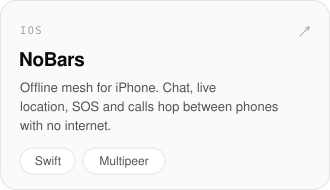

<h3>Swastik Dutt</h3>

**Incoming SDE at [JPMorgan Chase](https://github.com/jpmorganchase).**

Interned on the iOS Payments team at JPMorgan Chase. Final-year CS at Manipal University Jaipur. More at [swastikdutt.vercel.app](https://swastikdutt.vercel.app).

<picture>
  <source media="(prefers-color-scheme: dark)" srcset="assets/showreel-dark.svg">
  
</picture>

 

<table>
<tr>
<td width="50%" valign="top">
<a href="https://www.sketchracer.com"><picture><source media="(prefers-color-scheme: dark)" srcset="assets/sketchracer-dark.svg"></picture></a>

<b>How it's built</b>

 

Three.js world with car physics, nine missions, a stunt park and a radio that composes music live in the browser. You freehand-draw a loop and it's validated (closes up, no self-crossing, no corners too tight), then built into a real track with checkpoints and lap timing. F1 circuits load at real scale. Multiplayer rooms run on Cloudflare Durable Objects, up to 8 drivers, with your phone as a controller.

[Play](https://www.sketchracer.com) · [Code](https://github.com/Swastikkkkk/swastikk-drive)

</td>
<td width="50%" valign="top">
<a href="https://prepninja-tawny.vercel.app"><picture><source media="(prefers-color-scheme: dark)" srcset="assets/prepninja-dark.svg"></picture></a>

<b>How it's built</b>

 

NVIDIA Nemotron writes role-specific interview questions, transcribes video answers and scores them on five axes. Coding problems only keep test cases that the model's own solution passes in the Judge0 sandbox. A per-topic skill score drives a weekly study roadmap, benchmarked against BKT and DKT on ASSISTments.

[Live](https://prepninja-tawny.vercel.app) · [Code](https://github.com/Swastikkkkk/PrepNinja)

</td>
</tr>
<tr>
<td width="50%" valign="top">
<a href="https://chatsnitch.vercel.app"><picture><source media="(prefers-color-scheme: dark)" srcset="assets/chatsnitch-dark.svg"></picture></a>

<b>How it's built</b>

 

A Manifest V3 extension with one permission (`management`) and no network access. It reads every installed extension's host permissions and permission warnings (which catch content-script access the API leaves out), works out which can see ChatGPT, Claude or Gemini, and ranks the risk. Nothing leaves the browser. Built after a run of real extensions were caught exfiltrating AI chats.

[Site](https://chatsnitch.vercel.app) · [Code](https://github.com/Swastikkkkk/chatsnitch)

</td>
<td width="50%" valign="top">
<a href="https://jalnetra-lilac.vercel.app"><picture><source media="(prefers-color-scheme: dark)" srcset="assets/jalnetra-dark.svg"></picture></a>

<b>How it's built</b>

 

EventBridge runs a Lambda every 3 hours that checks 681 river points against GloFAS forecasts. When a river rises, it predicts which of 291 villages the water reaches and when. Bedrock drafts the advisory, a person approves it, and the village head gets a Hindi voice call. RDS keeps the call ledger, CloudFront and WAF sit in front.

[Live](https://jalnetra-lilac.vercel.app) · [Code](https://github.com/Swastikkkkk/jalnetra)

</td>
</tr>
</table>

<table>
<tr>
<td width="33%"><a href="https://github.com/Swastikkkkk/lerno"><picture><source media="(prefers-color-scheme: dark)" srcset="assets/lerno-dark.svg"></picture></a></td>
<td width="33%"><a href="https://github.com/Swastikkkkk/NoBars"><picture><source media="(prefers-color-scheme: dark)" srcset="assets/district-mesh-dark.svg"></picture></a></td>
<td width="33%"><a href="https://github.com/Swastikkkkk/disasterevac"><picture><source media="(prefers-color-scheme: dark)" srcset="assets/disasterar-dark.svg"></picture></a></td>
</tr>
</table>

<b>Experience</b>

 

**JPMorgan Chase** · Software Development Engineer · incoming 
Joining full time after graduation.

**JPMorgan Chase** · iOS Payments, Software Development Intern · 2026 
Moved Storyboard and UIKit payment flows in the Chase app to SwiftUI with MVVM.

**KPMG** · Academic Intern, Housing Ministry data analytics · 2025 
React dashboard and Node pipelines that cut manual reporting by over 40%.

**NetNivaran** · Web Development Intern · 2024 
Mobile-first rebuild, 60% faster load times.

<b>Wins</b>

 

**Smart India Hackathon 2025** · winner, out of 68,000+ teams 
**Google Codeclash 2.0** · first place with [ExplAInr](https://github.com/Swastikkkkk/lerno), 1,000+ teams 
**ZS Campus Beats 2026** · second runner-up, AI Builders 
13 hackathon wins in total

 

[Portfolio](https://swastikdutt.vercel.app) · [swastikdutt@gmail.com](mailto:swastikdutt@gmail.com) · [LinkedIn](https://www.linkedin.com/in/swastik-dutt-150b61280/) · [X](https://x.com/SwastikDutt)
