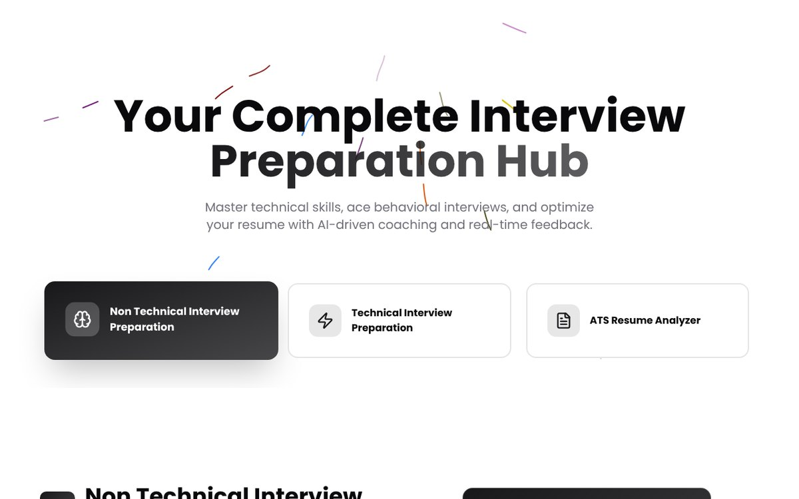
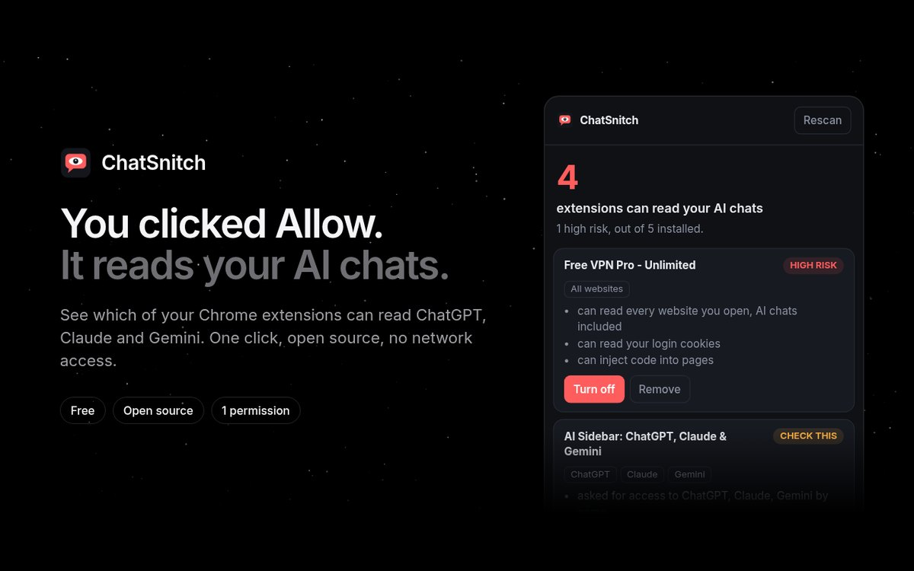
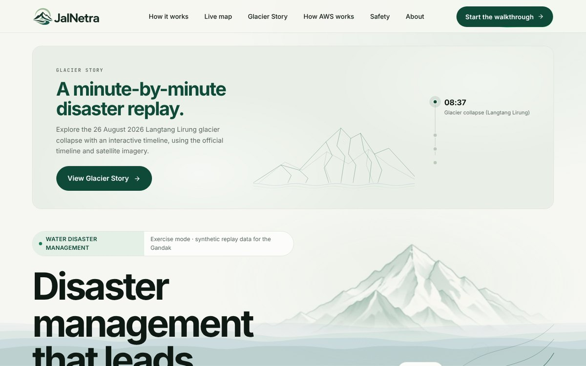

### Hi, I'm Swastik.

I build AI products end to end: the model or agent, the API around it, the web app, and the iOS client when it needs one.

Final-year CS (Data Science) at Manipal University Jaipur. This summer I was on the iOS Payments team at JPMorgan Chase.

 

<table>
  <tr>
    <td width="50%" valign="top">
      
        
      <b>SketchRacer</b> 
      Open-world driving game in the browser. Draw any track and race it, or drive real F1 circuits at full scale.
        
      <a href="https://www.sketchracer.com">Play</a> &nbsp;·&nbsp; <a href="https://github.com/Swastikkkkk/swastikk-drive">Code</a> &nbsp;·&nbsp; Three.js, Supabase
    </td>
    <td width="50%" valign="top">
      
        
      <b>PrepNinja</b> 
      Proctored AI mock interviews, coding rounds with a sandboxed runner, and an ATS resume check. Skill scoring benchmarked against BKT and DKT.
        
      <a href="https://prepninja-tawny.vercel.app">Live</a> &nbsp;·&nbsp; <a href="https://github.com/Swastikkkkk/PrepNinja">Code</a> &nbsp;·&nbsp; React, Node, Gemini, Judge0
    </td>
  </tr>
  <tr>
    <td width="50%" valign="top">
      
        
      <b>ChatSnitch</b> 
      Shows which of your Chrome extensions can read your ChatGPT, Claude and Gemini chats. One permission, no network access.
        
      <a href="https://chatsnitch.vercel.app">Site</a> &nbsp;·&nbsp; <a href="https://github.com/Swastikkkkk/chatsnitch">Code</a> &nbsp;·&nbsp; Manifest V3, JavaScript
    </td>
    <td width="50%" valign="top">
      
        
      <b>JalNetra</b> 
      Flood early warning. Watches 681 river points, predicts which villages the water reaches, and places a Hindi voice call once a person approves.
        
      <a href="https://d1oi8xa605dsj6.cloudfront.net">Live</a> &nbsp;·&nbsp; <a href="https://github.com/Swastikkkkk/jalnetra">Code</a> &nbsp;·&nbsp; AWS Lambda, Bedrock, RDS
    </td>
  </tr>
</table>

**More**

| Project | What it does | Built with |
| --- | --- | --- |
| [District Mesh](https://github.com/Swastikkkkk/District_Mesh) | Offline mesh for iPhone. Messages, live location, SOS and calls hop between phones with no internet. | Swift |
| [AmExpert](https://github.com/Swastikkkkk/amexpert) | Agent that resolves card-servicing requests over voice, WhatsApp, SMS and email, with a deterministic policy engine. | Node, LangGraph |
| [agentdrift](https://github.com/Swastikkkkk/agentdrift) | Finds rules that clash across AGENTS.md, CLAUDE.md and .cursorrules, then merges them into one file. | Python |
| [DisasterAR](https://github.com/Swastikkkkk/disasterevac) | Indoor evacuation in AR that works fully offline, routing around hazards to the nearest safe exit. | Swift, ARKit |
| [Guardian](https://github.com/Swastikkkkk/guardian-backend) | Safe-route engine that scores streets from OSM, weather and camera events. | FastAPI |
| [brag-ext](https://github.com/Swastikkkkk/brag-ext) | Turns any GitHub repo into a short promo video. Voices run locally in the browser. | TypeScript, Remotion |

**Experience**

| Company | Role | Year |
| --- | --- | --- |
| JPMorgan Chase | iOS Payments, Software Development Intern | 2026 |
| KPMG | Data analytics for the Housing Ministry, Academic Intern | 2025 |
| NetNivaran | Web Development Intern | 2024 |

**Wins**

Smart India Hackathon 2025, winner out of 68,000+ teams. Google Codeclash 2.0, first place. ZS Campus Beats 2026, second runner-up in AI Builders. Ten-plus hackathons in total.

**Stack**

Swift and SwiftUI · TypeScript, React, Next.js, Node · Python, FastAPI, PyTorch · Supabase, Firebase, AWS, Vercel · Claude and Gemini APIs, agents, RAG

 

[swastikdutt@gmail.com](mailto:swastikdutt@gmail.com) &nbsp;·&nbsp; [LinkedIn](https://www.linkedin.com/in/swastik-dutt-150b61280/)
