<a href="https://swastikkkkk.github.io">
<picture>
  <source media="(prefers-color-scheme: dark)" srcset="assets/header-dark.svg">
  
</picture>
</a>

  

<a href="https://www.sketchracer.com">
<picture>
  <source media="(prefers-color-scheme: dark)" srcset="assets/showreel-dark.svg">
  
</picture>
</a>

<a href="https://www.sketchracer.com"><b>SketchRacer</b></a> &nbsp;·&nbsp;
<a href="https://prepninja-tawny.vercel.app"><b>PrepNinja</b></a> &nbsp;·&nbsp;
<a href="https://chatsnitch.vercel.app"><b>ChatSnitch</b></a> &nbsp;·&nbsp;
<a href="https://d1oi8xa605dsj6.cloudfront.net"><b>JalNetra</b></a>

<b>How they're built</b>

 

**SketchRacer** · [Play](https://www.sketchracer.com) · [Code](https://github.com/Swastikkkkk/swastikk-drive) 
Three.js world with car physics, nine missions, a stunt park and a radio that composes music live in the browser. You freehand-draw a loop and it's validated (closes up, no self-crossing, no corners too tight), then built into a real track with checkpoints and lap timing. F1 circuits load at real scale. Multiplayer rooms run on Cloudflare Durable Objects, up to 8 drivers, with your phone as a controller.

**PrepNinja** · [Live](https://prepninja-tawny.vercel.app) · [Code](https://github.com/Swastikkkkk/PrepNinja) 
NVIDIA Nemotron writes role-specific interview questions, transcribes video answers and scores them on five axes. Coding problems only keep test cases that the model's own solution passes in the Judge0 sandbox. A per-topic skill score drives a weekly study roadmap, benchmarked against BKT and DKT on ASSISTments.

**ChatSnitch** · [Site](https://chatsnitch.vercel.app) · [Code](https://github.com/Swastikkkkk/chatsnitch) 
A Manifest V3 extension with one permission (`management`) and no network access. It reads every installed extension's host permissions and permission warnings, works out which can see ChatGPT, Claude or Gemini, and ranks the risk. Nothing leaves the browser.

**JalNetra** · [Live](https://d1oi8xa605dsj6.cloudfront.net) · [Code](https://github.com/Swastikkkkk/jalnetra) 
EventBridge runs a Lambda every 3 hours that checks 681 river points against GloFAS forecasts. When a river rises, it predicts which of 291 villages the water reaches and when. Bedrock drafts the advisory, a person approves it, and the village head gets a Hindi voice call.

 

<a href="https://github.com/Swastikkkkk/lerno"><picture><source media="(prefers-color-scheme: dark)" srcset="assets/lerno-dark.svg"></picture></a>
<a href="https://github.com/Swastikkkkk/NoBars"><picture><source media="(prefers-color-scheme: dark)" srcset="assets/district-mesh-dark.svg"></picture></a>
<a href="https://github.com/Swastikkkkk/disasterevac"><picture><source media="(prefers-color-scheme: dark)" srcset="assets/disasterar-dark.svg"></picture></a>

  

<picture>
  <source media="(prefers-color-scheme: dark)" srcset="assets/experience-dark.svg">
  
</picture>

  

<a href="https://www.sketchracer.com">
<picture>
  <source media="(prefers-color-scheme: dark)" srcset="assets/arcade-dark.svg">
  
</picture>
</a>

  

<picture>
  <source media="(prefers-color-scheme: dark)" srcset="https://raw.githubusercontent.com/Swastikkkkk/swastikkkkk/output/snake-dark.svg">
  
</picture>

<b>All wins</b>

 

**Smart India Hackathon 2025** · winner, out of 68,000+ teams 
**Google Codeclash 2.0** · first place with [ExplAInr](https://github.com/Swastikkkkk/lerno), 1,000+ teams 
**ZS Campus Beats 2026** · second runner-up, AI Builders 
13 hackathon wins in total

 

<a href="https://swastikkkkk.github.io">Portfolio</a> &nbsp;·&nbsp;
<a href="mailto:swastikdutt@gmail.com">swastikdutt@gmail.com</a> &nbsp;·&nbsp;
<a href="https://www.linkedin.com/in/swastik-dutt-150b61280/">LinkedIn</a> &nbsp;·&nbsp;
<a href="https://x.com/SwastikDutt">X</a>

